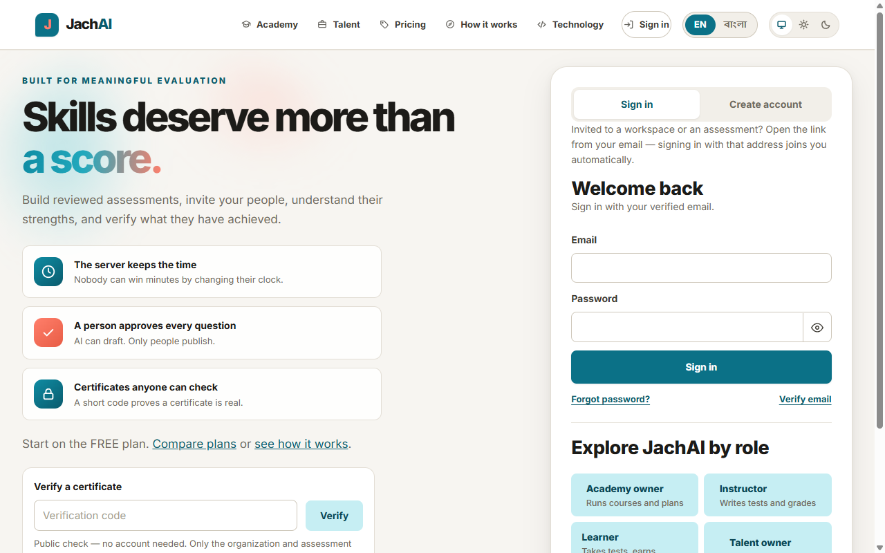
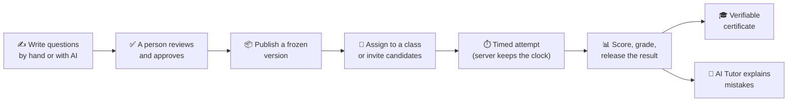
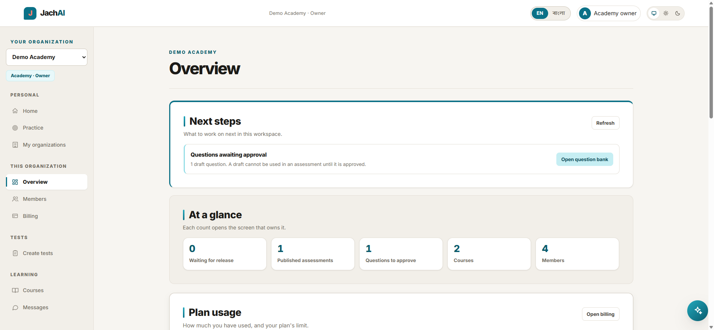
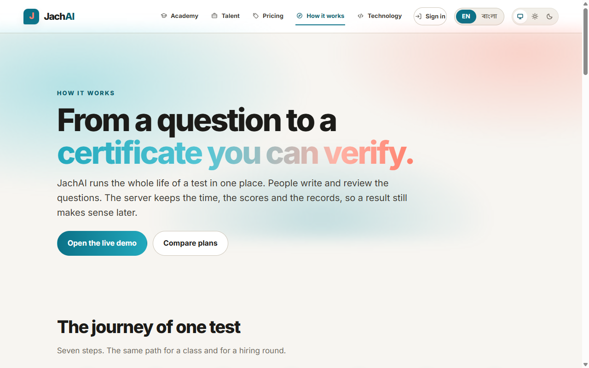
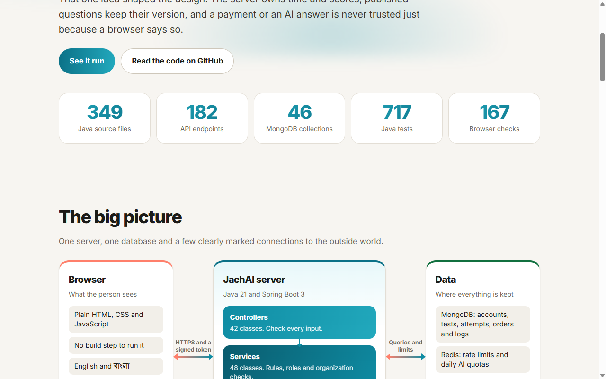
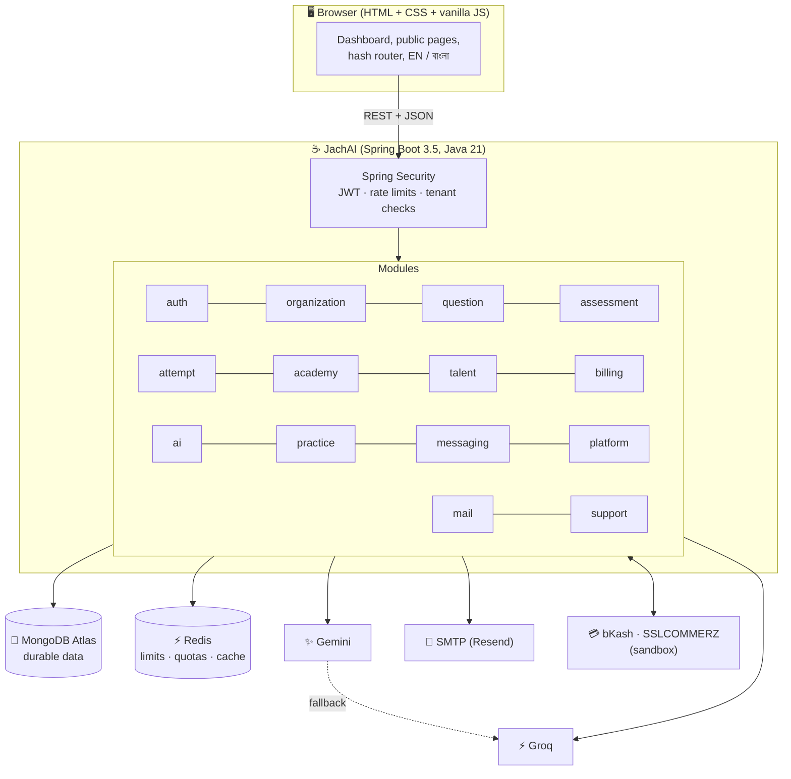
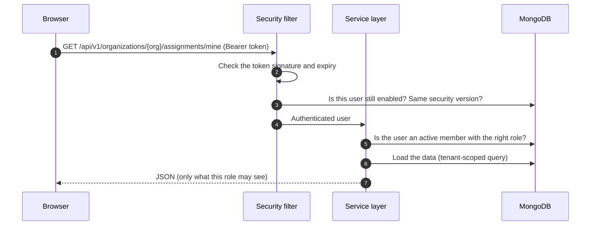

<div align="center">

# 🎓 JachAI

### Skills deserve more than a score.

**A tests-and-certificates platform for schools, training centres and hiring teams.**
People write and review the questions. The server keeps the time, the scores and the records. A certificate can be checked by anyone.

[](https://jachai.nazmulhsn.me)
[](https://openjdk.org/projects/jdk/21/)
[](https://spring.io/projects/spring-boot)
[](https://www.mongodb.com/atlas)
[](https://redis.io)
[](Dockerfile)
[](#-testing)
[](#-for-bangla-readers--বাংলায়-সারসংক্ষেপ)

[**Open the live demo**](https://jachai.nazmulhsn.me) · [How it works](https://jachai.nazmulhsn.me/how.html) · [How it's built](https://jachai.nazmulhsn.me/engineering.html) · [Pricing](https://jachai.nazmulhsn.me/plans.html)



</div>

> **Try it in 10 seconds.** Open the [live demo](https://jachai.nazmulhsn.me) and press one of the six role buttons (Academy owner, Instructor, Learner, Talent owner, Recruiter, Candidate). No sign-up and no password. The demo runs on a free server, so the very first visit after a quiet period can take up to a minute while it wakes up.

---

## 📑 Contents

[What is it?](#-what-is-it) · [Who gets what](#-who-gets-what-and-why-it-helps) · [Screens](#-screens) · [Features](#-features-in-detail) · [Architecture](#-architecture) · [Tech stack](#-tech-stack) · [Run it](#-run-it-yourself) · [Settings](#-settings-you-will-need) · [Testing](#-testing) · [Project map](#-project-map) · [Honest status](#-honest-status) · [Bangla](#-for-bangla-readers--বাংলায়-সারসংক্ষেপ) · [Docs](#-more-documentation)

---

## 💡 What is it?

Most online tests have the same weak spots: the timer lives in the browser, the questions can change after people have started, a score is just a number, and a certificate is a picture anyone can edit.

JachAI keeps the **whole life of a test in one place** and makes the server, not the browser, the source of truth:



It serves two worlds with one account:

| 🏫 **Academy** (learning) | 💼 **Talent** (hiring) |
| --- | --- |
| Courses and dated batches, learners, tests, instructor feedback, messages, certificates. | Hiring campaigns, invite candidates by email, compare results side by side, reviewer notes and decisions. |

And anyone can use **Practice** alone, with no organization: take a quick skill check, practise a topic in a short session with a score at the end, or ask the AI for a question of your own.

---

## 🎯 Who gets what, and why it helps

Every row below is something the product really does today.

### 🏫 Teachers, training centres and schools (Academy)

| What you get | Why it helps you |
| --- | --- |
| **Question bank with review.** AI drafts are never used until a person approves them. | You get the speed of AI without trusting it blindly. Nothing wrong reaches a student by accident. |
| **Frozen versions.** Publishing a test makes an unchangeable copy. | If you fix a typo later, students who already started are not affected, and old scores stay fair. |
| **Courses and batches.** Enrol a learner once; tests assigned to the batch reach them (and new joiners get them automatically). | No more adding every student to every test by hand. A "reconcile" button repairs any assignment that was missed. |
| **Batch progress and analytics.** Submitted, graded, waiting for grading, passed, average score. | You see who is stuck at a glance. Short answers still waiting for you are not counted as failures. |
| **Learning progress, test by test.** For each test in a batch: how many finished, how many were marked, how many passed. | You see how far the whole class has come, and where it stalls. |
| **Result release control.** Show results at once, or hold them until you press release. | You can finish grading first, then everybody sees their result at the same time. |
| **Instructor feedback.** Save a private draft, publish later. The learner gets an email. | Personal comments reach the right student, and drafts stay private. |
| **Certificates with your wording, logo and signature.** Learners print their own. | Your institute's name is on it, and nobody needs to phone you to check it. |
| **Direct messages between instructor and learner.** | Questions stay inside the platform. Only those two people can read the chat. |

### 🎓 Learners

| What you get | Why it helps you |
| --- | --- |
| **Fair, timed tests.** The server keeps the deadline. | Nobody can gain time by editing the page, so the result means something. |
| **AI Tutor after the result.** It explains your mistakes, in English or বাংলা. | You learn from each test. It is switched off while an attempt is open, so it cannot give away answers. |
| **Guided Practice.** A four-question skill check, short sessions on Java, Spring, Web or MongoDB, a recap with the right answer and why, and a suggestion for what to practise next. Free AI questions on any topic too (20 per day). | You learn where you are weak, not just what you got wrong, and you always know what to do next. |
| **Certificates anyone can verify.** A short code opens a public page with the organization and test names (never your private details). | You can show an employer a link that proves it is real. |
| **Bangla and English everywhere**, plus a dark theme. | You can use the platform in the language you think in. |

### 💼 Hiring teams (Talent)

| What you get | Why it helps you |
| --- | --- |
| **One frozen test for every candidate.** | Everyone answers the same questions under the same rules, so the comparison is fair. |
| **Invite by email.** Candidates open the link, sign in with that address, and the test is assigned. | No spreadsheets, no copying links. Only the invited address can accept. |
| **Side-by-side candidate comparison, notes, shortlist / hold / reject decisions** with a history. | A hiring decision you can explain later, with who decided what and when. |
| **Hiring funnel.** From email invitation to test, submission, marking, shortlist and **hired**, with rejected counted separately. | You can see where candidates drop out and how long the round really is. |
| **Integrity signals** (tab switches, copy and paste, leaving full screen). | Useful context for a reviewer. They are only hints: a candidate can hide them, so JachAI **never** decides "cheating" automatically. |

### 🛠️ Workspace owners and platform admins

| What you get | Why it helps you |
| --- | --- |
| **FREE and TEAM plans per organization**, with limits enforced on the server. | You start free and upgrade when you grow. A plan can only change after the server has verified a payment. |
| **Payments:** direct bKash and SSLCOMMERZ sandbox checkouts, plus a built-in demo checkout, a receipt email and an admin log. | You can try the full upgrade journey safely. No real money is taken. |
| **Roles and invitations.** Owner, admin, instructor, recruiter, learner, candidate. | Each person sees only what their role needs. Every request is checked again on the server. |
| **Platform admin area.** Organizations, billing summaries, quota checks and repairs, support access with an audit trail. | Operators can help customers without reading private answers. Every support access is recorded. |
| **Support tickets** inside the app. | People ask for help without leaving the platform. |

---

## 🖼️ Screens

<table>
<tr>
<td width="50%"><b>Workspace dashboard</b> (Academy owner)<br></td>
<td width="50%"><b>"How it works"</b> page, in the app<br></td>
</tr>
<tr>
<td colspan="2"><b>"How it's built"</b> page: the stack and the problems it solved<br></td>
</tr>
</table>

---

## ✨ Features in detail

<details>
<summary><b>📝 Assessments and attempts</b></summary>

- Questions: multiple choice and short text. Draft → approved → used in a test.
- Publishing creates an **immutable version**. Later edits make a new version; old assignments keep their original one.
- **Server-timed attempts.** The deadline is stored on the server; answers are saved one by one.
- Multiple-choice answers are scored by the server. Short answers wait for a person to mark them right or wrong (audited, final).
- Result release: `IMMEDIATE` or `MANUAL`, set per organization or per test, frozen into the version.
- Staff can inspect a submitted attempt (questions, choices, answer key) without releasing the result.
- Email reminders to people who have not started yet (at most one per day per assignment).
</details>

<details>
<summary><b>🤖 AI, with limits</b></summary>

- **Question drafting** uses Google Gemini. If Gemini is slow or down, it **fails over to Groq automatically** (circuit breaker included).
- **AI Tutor** (after results are visible) uses Groq, and can fall back too. It never scores an active exam.
- Local **Ollama** is supported for offline development.
- Daily limits per user and per organization are enforced with atomic counters. A failed generation refunds the allowance.
- AI output is always a draft until a person approves it.
</details>

<details>
<summary><b>🎯 Guided Practice</b></summary>

- A starting skill check of four questions (one per topic) and four topic paths: Java, Spring, Web and MongoDB.
- A session has a fixed set of questions. Each answer is saved by the server (answering twice with a different choice is refused). When the last question is answered, the recap shows the score, your answer, the right answer and a short explanation for each question.
- "Practise next" looks at your recent finished sessions and points to the topic with the lowest accuracy. With no finished session it suggests the skill check.
- Sessions use the same daily answer limit as normal Practice, and are removed after 90 days.
</details>

<details>
<summary><b>🎓 Certificates</b></summary>

- Issued only for a passing, released result. The same attempt cannot be issued twice.
- A design (wording, signer, optional PNG/JPEG logo and signature) is saved as an immutable version.
- Public verification shows only organization and test names and dates, never the holder's identity.
- Staff can revoke a certificate. A revoked one stays findable but shows as invalid. Issue and revoke actions are audited.
</details>

<details>
<summary><b>💳 Plans and payments</b></summary>

- `FREE` and `TEAM` limits: published tests, monthly invitations, AI requests, certificates.
- Quota slots are reserved atomically before a write and refunded on a handled failure.
- Gateways: **bKash** (tokenized sandbox) and **SSLCOMMERZ** (sandbox), plus an optional built-in **demo checkout** (`BILLING_DEMO_CHECKOUT`).
- The server verifies payment ID, order ID, transaction ID, amount, currency and status before granting TEAM. A browser redirect alone never upgrades a plan, and a repeated callback cannot add the term twice.
- A receipt email is sent after a verified payment. Admins see order history and can press "Check payment" if a callback was lost.
</details>

<details>
<summary><b>🔐 Security and reliability</b></summary>

- Email sign-up with verification, login with JWT access tokens and **rotating refresh tokens**, optional Google sign-in.
- Password reset is single-use and ends all older sessions (per-user security version).
- **Tenant checks in the service layer** on every request; the interface only reflects them.
- Redis rate limits for login, registration, reset, certificate checks, invitations and AI bursts. Keys hold **HMAC digests**, not raw emails or IPs. In production it fails closed.
- **Email outbox** in MongoDB: payloads encrypted at rest, retried with back-off, and the link is re-checked before it is sent.
- Profile pictures are re-encoded and limited in size on the server.
- Health check at `/api/v1/health` that also keeps the database connection warm.
</details>

<details>
<summary><b>✉️ Emails</b></summary>

Verification, password reset, test and workspace invitations, certificate ready, result available, instructor feedback, reminders, payment receipt and support updates are sent as **designed HTML emails** (with a plain-text version for old mail apps).
</details>

<details>
<summary><b>🌍 Interface</b></summary>

Responsive layout for phone and desktop, English and বাংলা on every page, light / dark / system theme, keyboard-friendly navigation, a "server is waking up" hint on free hosting, and one consistent header on every page. No front-end build step: plain HTML, CSS and JavaScript served by Spring.
</details>

---

## 🏗️ Architecture

One deployable Spring Boot application (a **modular monolith**). It serves both the web pages and the REST API.



**Why one app and not microservices?** The team is small and runs on free tiers. One process is cheaper, easier to debug and easier to deploy, while the package-per-module layout keeps boundaries clear enough to split later.

**Where does the truth live?** MongoDB holds all durable data. Redis only speeds things up and counts limits. If Redis cannot confirm a limit in production, the request is refused rather than allowed.

### A request, step by step



---

## 🧰 Tech stack

| Layer | Used | Why |
| --- | --- | --- |
| Language / runtime | **Java 21** | Modern language features and a fast JVM. |
| Framework | **Spring Boot 3.5** (Web, Validation, Security, OAuth2 resource server, Actuator) | One mature framework for the API, security and health checks. |
| Pages | **Thymeleaf** + hand-written **HTML / CSS / vanilla JavaScript** (no build step) | Pages work without a bundler, and the whole UI can be read in the repo. |
| Database | **MongoDB Atlas** (Spring Data MongoDB) | Flexible documents for assessments and versions, TTL indexes for expiring data. |
| Cache / limits | **Redis** (Spring Data Redis) | Fast atomic counters for rate limits and quotas, published-version cache. |
| AI | **Spring AI**: Google Gemini, Groq (OpenAI-compatible), Ollama | Provider chain with automatic fallback. |
| Email | Spring Mail over SMTP (Resend or Gmail) with a MongoDB outbox | Retryable delivery that survives restarts. |
| Payments | bKash and SSLCOMMERZ (sandbox) | Popular gateways in Bangladesh. |
| Auth | JWT, rotating refresh tokens, Google Identity Services | No third-party identity platform to pay for. |
| Packaging | **Maven**, multi-stage **Dockerfile** | Same build locally and on the host. |
| Hosting (demo) | **Render** (Singapore) + **MongoDB Atlas** (Singapore) | Free tier. |
| Tests | JUnit 5, Spring Test, Mockito; a no-dependency Node journey runner driving real Chrome / Edge | Fast checks for logic, plus checks of the real screens. |

---

## 🚀 Run it yourself

You need **JDK 21**, a **MongoDB** connection string (a free Atlas cluster is fine) and a long random secret. On Windows the helper scripts do the rest.

### Fastest: a throw-away demo with one-click roles (Windows)

```powershell
$env:MONGODB_URI = '<your Atlas connection string, without a database name>'
powershell -ExecutionPolicy Bypass -File .\scripts\start-local.ps1 -Demo
```

The script checks that MongoDB is reachable, picks a free port, and prints the address. Open it and press a role button. Demo accounts only work with the demo setup and cannot change a password.

### Any system, with Maven

```bash
export JWT_SECRET='<at least 32 random characters>'
export MONGODB_URI='<your Atlas connection string, without a database name>'
./mvnw spring-boot:run          # Windows: .\mvnw.cmd spring-boot:run
```

Open <http://localhost:8080>. Without mail settings, verification and reset links are printed in the console instead of being emailed.

### With Docker

```bash
docker build -t jachai .
docker run --rm -p 8080:8080 --env-file .env.production jachai
```

`.env.example` lists every setting with placeholders. **Never commit real keys.**

---

## ⚙️ Settings you will need

| Variable | Needed? | What it is for |
| --- | --- | --- |
| `MONGODB_URI` | **Yes** | Atlas cluster and credentials (no database name in it). |
| `JWT_SECRET` | **Yes** | Signs login tokens. At least 32 bytes. Keep it stable or everyone is signed out. |
| `APP_PUBLIC_BASE_URL` | **Yes** in production | Your public HTTPS address. Used in email links and payment callbacks. |
| `REDIS_HOST` (+ `REDIS_PASSWORD`, `REDIS_SSL_ENABLED`) | **Yes** in production | Rate limits, quotas and cache. |
| `MAIL_HOST`, `MAIL_USERNAME`, `MAIL_PASSWORD`, `MAIL_FROM` (`MAIL_PORT`) | **Yes** in production | Sends emails. Resend and Gmail both work. |
| `GEMINI_API_KEY`, `GROQ_API_KEY` | Optional | AI question drafts and the AI Tutor. |
| `GOOGLE_CLIENT_ID` | Optional | Shows "Continue with Google". |
| `SSLCOMMERZ_SANDBOX_*`, `BKASH_SANDBOX_*` | Optional | Sandbox payment gateways. |
| `BILLING_DEMO_CHECKOUT` | Optional | Built-in demo checkout, for trying upgrades without a gateway. |
| `DEMO_PUBLIC_ACCESS` | Optional | Turns on the one-click demo roles on a public site. Do not use with real customer data. |
| `PLATFORM_ADMIN_USER_IDS` | Optional | Comma-separated user IDs that become platform admins. |

Full details, the Render checklist and the custom-domain steps are in [SYSTEM.md](SYSTEM.md).

---

## 🧪 Testing

```bash
./mvnw test                                  # 733 Java tests
node src/test/frontend/run-journeys.js       # 176 browser checks, real Chrome/Edge, no install needed
```

- **Java tests** cover assessment and attempt rules, tenant isolation, payments, email templates, AI fallback, security and the web layer.
- **Browser journeys** open the real pages and click through them: all six roles, mobile widths, language switch, theme, avatar upload, support page. The server answers are fixtures, so these prove the screens, not the live backend.
- Evidence files are written to `target/`. Both suites run with no database.

---

## 🗂️ Project map

```text
jachAI/
├─ src/main/java/com/jachai/
│  ├─ auth/  organization/  question/  assessment/  attempt/    ← the core test flow
│  ├─ academy/  talent/  practice/  messaging/                  ← products built on it
│  ├─ ai/  billing/  mail/  support/  platform/                 ← AI, money, email, help, operators
│  └─ shared/                                                   ← security, config, health, errors
├─ src/main/resources/
│  ├─ templates/        public pages (Thymeleaf)
│  └─ static/           app.js, i18n.js (EN ⇄ বাংলা), CSS, theme
├─ src/test/            Java tests + frontend journey runner
├─ docs/                reference notes, engineering story, images
├─ scripts/             Windows helpers (start-local, check-mongo, ...)
├─ Dockerfile           multi-stage build for Render or any container host
└─ SYSTEM.md · ARCHITECTURE.md · BACKEND.md · FRONTEND.md
```

---

## 🧭 Honest status

JachAI is a working, tested **demo-grade platform**, not a certified production service. Being clear about this matters more than looking finished:

- ✅ Works and is tested: the full test flow, the six roles, AI drafts with fallback, the AI Tutor, certificates, the Bangla and English interface, the payment checkouts in sandbox mode, email sending.
- 🧪 **Payments are sandbox only.** No real-money endpoint is turned on, and the demo checkout charges nothing.
- ☁️ The live demo runs on **free hosting**. It sleeps when idle, so the first request after a quiet period is slow.
- 👥 Demo roles are **shared**: anyone with the link can change that demo data. Never store real customer records there.
- 📋 Still to verify against live services before any real launch: MongoDB concurrency and TTL behaviour at scale, Google sign-in on the public site, both payment sandboxes with real merchant credentials, and rate limits behind a load balancer. See "Release gates" in [SYSTEM.md](SYSTEM.md).
- Integrity signals and AI output are **aids for people**, never automatic verdicts.

---

## 🇧🇩 For Bangla readers · বাংলায় সারসংক্ষেপ

**JachAI কী?** স্কুল, কোচিং সেন্টার, প্রশিক্ষণ প্রতিষ্ঠান আর নিয়োগকারী দলের জন্য একটা পরীক্ষা ও সার্টিফিকেটের প্ল্যাটফর্ম। প্রশ্ন লেখে ও যাচাই করে মানুষ। সময়, নম্বর আর রেকর্ড রাখে সার্ভার। সার্টিফিকেট যে কেউ যাচাই করতে পারে।

**কার কী লাভ?**

- 🏫 **শিক্ষক ও প্রতিষ্ঠান:** AI প্রশ্নের খসড়া লেখে, কিন্তু আপনি অনুমোদন না করলে সেটা কারও কাছে যায় না। পরীক্ষা প্রকাশ করলে তার একটা অপরিবর্তনীয় কপি তৈরি হয়, তাই পরে ভুল শুধরালেও আগের পরীক্ষার্থীদের নম্বর ঠিক থাকে। ব্যাচ বানিয়ে একবারে সবাইকে পরীক্ষা দেওয়া যায়, আর কে আটকে আছে এক নজরে দেখা যায়।
- 🎓 **শিক্ষার্থী:** সময় রাখে সার্ভার, তাই পরীক্ষা সবার জন্য ন্যায্য। ফল দেখার পর AI টিউটর ভুলগুলো বুঝিয়ে দেয় (বাংলা বা ইংরেজিতে)। একা অনুশীলনের জন্য বিনামূল্যে Practice আছে (দিনে ২০টা প্রশ্ন)।
- 💼 **নিয়োগকারী দল:** সব প্রার্থী একই প্রশ্নে একই নিয়মে পরীক্ষা দেন। ইমেইলে আমন্ত্রণ যায়, ফলাফল পাশাপাশি তুলনা করা যায়, আর কে কী সিদ্ধান্ত নিল তার ইতিহাস থাকে।
- 🛠️ **মালিক ও অ্যাডমিন:** বিনামূল্যে শুরু করে পরে TEAM প্ল্যানে যাওয়া যায়। পেমেন্ট সার্ভার যাচাই না করলে প্ল্যান বদলায় না।

**নিজে চালাতে:** JDK 21, একটা MongoDB Atlas লিংক আর একটা বড় গোপন `JWT_SECRET` লাগে। উপরের [Run it yourself](#-run-it-yourself) অংশ দেখুন।

**সৎ কথা:** এটা ডেমো-মানের প্ল্যাটফর্ম। পেমেন্ট শুধু স্যান্ডবক্সে (আসল টাকা কাটে না)। ফ্রি সার্ভারে চলে বলে অনেকক্ষণ ব্যবহার না হলে প্রথমবার খুলতে এক মিনিটের মতো লাগতে পারে।

---

## 📚 More documentation

| File | What is inside |
| --- | --- |
| [ARCHITECTURE.md](ARCHITECTURE.md) | Product rules, roles, data boundaries, acceptance criteria. |
| [BACKEND.md](BACKEND.md) | Backend boundaries, demo-account rules, test entry points. |
| [FRONTEND.md](FRONTEND.md) | The HTML / CSS / JavaScript UI and its conventions. |
| [SYSTEM.md](SYSTEM.md) | Settings, deployment, health checks, release gates. |
| [docs/ENGINEERING.md](docs/ENGINEERING.md) | The stack and the hard problems we solved. Also live at [/engineering.html](https://jachai.nazmulhsn.me/engineering.html). |
| [docs/REFERENCE.md](docs/REFERENCE.md) | Detailed workflow notes, setup steps and the full API route table. |

<div align="center">

Built by **Nazmul** · If this helped you, a ⭐ on the repo is very welcome.

</div>
