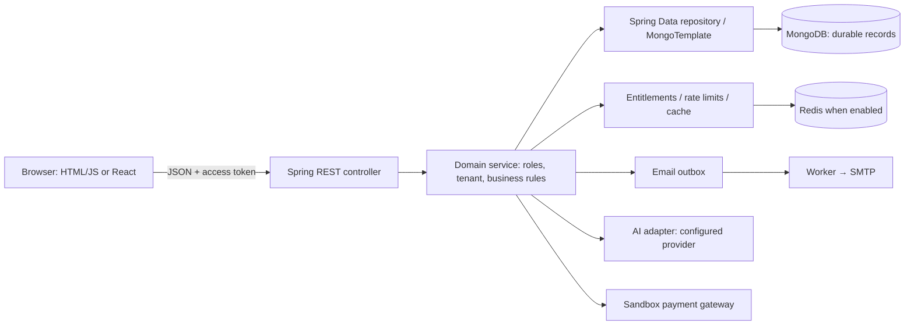
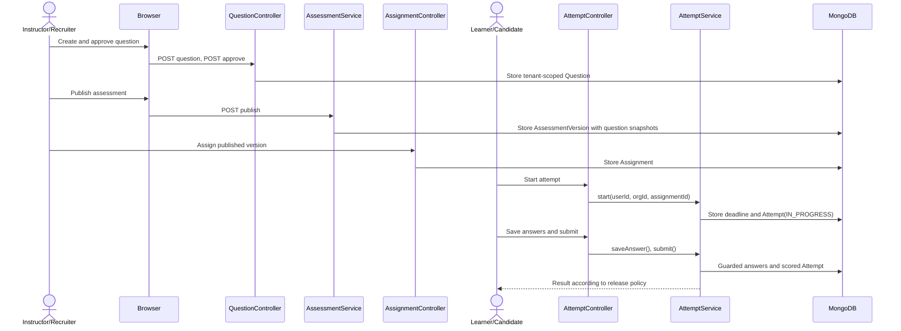
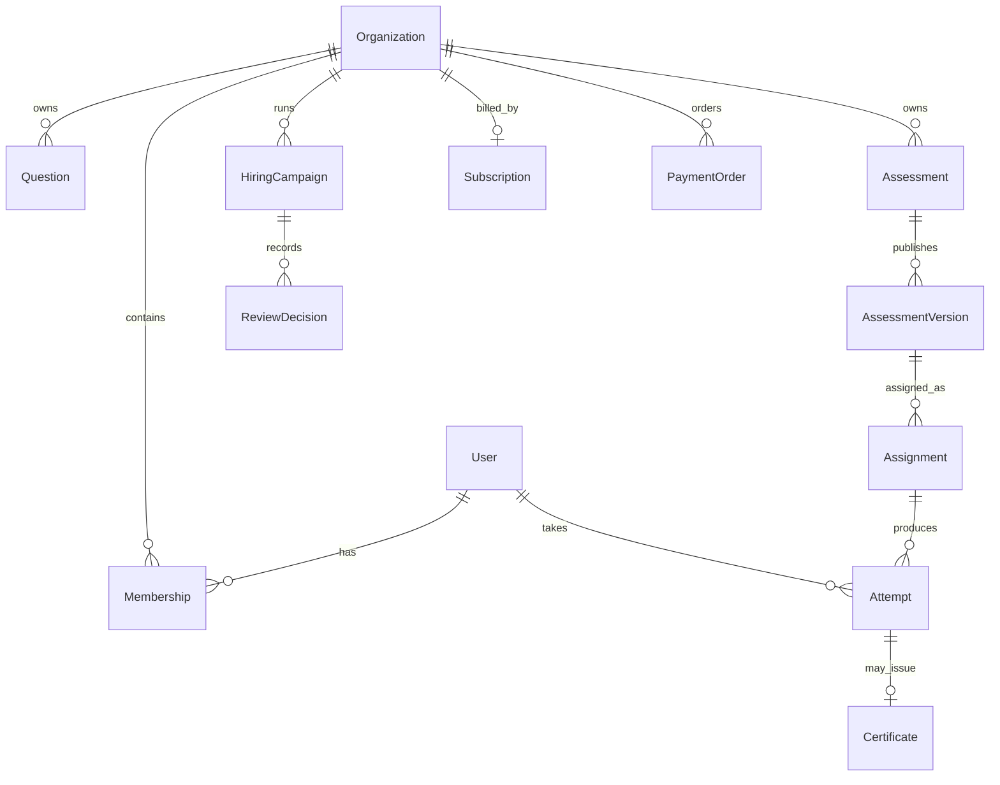

# JachAI: Project and Code Guide

> **Reading order:** one-minute overview → system map → complete request journey → module map → design decisions → documented problems and limits. This guide describes the repository as inspected on October 21, 2026. `ARCHITECTURE.md` also contains planned behavior; claims here are tied to the current code.

## 1. Explain the project in one minute

“JachAI is a multi-tenant assessment platform. Academy lets instructors manage courses, batches, assessments, feedback, and certificates. Talent lets recruiters manage hiring campaigns, compare candidates, and record hiring decisions. Both use the same assessment engine: question drafting and approval, immutable published versions, assignments, timed attempts, deterministic scoring, and controlled result release. The backend uses Java 21, Spring Boot, MongoDB, and Redis for selected transient controls. The UI includes server-served HTML/JavaScript and a React practice area. AI helps draft questions and explain completed attempts; it does not determine official scores.”

**Personal contribution:** The repository alone cannot prove which parts one person wrote. When presenting the project, distinguish your own implementation and decisions from the codebase as a whole.

## 2. The system in one picture

The application is a **modular monolith organized by domain**. Controllers handle HTTP and validation; services enforce business rules; repositories store and query data. One deployment keeps integration and operations simpler than separate services. The trade-off is that modules cannot be deployed or scaled independently today. See [Architecture](../ARCHITECTURE.md) and [Maven dependencies](../pom.xml).

### The usual path through the code

`Browser action → frontend request → controller endpoint → service authorization and rules → repository → Mongo document → response DTO → UI render`.

The request does not normally enter a persistence model first. A **DTO** defines the API boundary; a **model** represents stored domain state. Spring Security authenticates the JWT before the controller runs. The service still checks organization membership and access.

## 3. Module-by-module code map

Paths below are under `src/main/java/com/jachai/`. Follow each module's `controller → service → repository → model/DTO` path. Some repositories use `MongoRepository`; others use a custom `MongoTemplate` implementation.

| Module | Main code | Purpose and connections |
| --- | --- | --- |
| `auth` | [AuthController](../src/main/java/com/jachai/auth/controller/AuthController.java), [AuthService](../src/main/java/com/jachai/auth/service/AuthService.java), [User](../src/main/java/com/jachai/auth/model/User.java), [JwtService](../src/main/java/com/jachai/auth/service/JwtService.java) | Registration, verification, login, refresh, and reset. Supplies identity to every protected module. |
| `organization` | [OrganizationController](../src/main/java/com/jachai/organization/controller/OrganizationController.java), [MembershipService](../src/main/java/com/jachai/organization/service/MembershipService.java), [TenantAccessService](../src/main/java/com/jachai/organization/service/TenantAccessService.java), [Membership](../src/main/java/com/jachai/organization/model/Membership.java) | Workspaces and tenant-specific roles. Central access check for organization-owned data. |
| `question` | [QuestionController](../src/main/java/com/jachai/question/controller/QuestionController.java), [QuestionService](../src/main/java/com/jachai/question/service/QuestionService.java), [Question](../src/main/java/com/jachai/question/model/Question.java) | Question drafting, editing, and approval; approved questions feed assessment snapshots. |
| `assessment` | [AssessmentController](../src/main/java/com/jachai/assessment/controller/AssessmentController.java), [AssessmentService](../src/main/java/com/jachai/assessment/service/AssessmentService.java), [AssessmentVersion](../src/main/java/com/jachai/assessment/model/AssessmentVersion.java) | Assessment configuration and immutable published versions. Assignments reference a specific version. |
| `attempt` | [AssignmentController](../src/main/java/com/jachai/attempt/controller/AssignmentController.java), [AttemptController](../src/main/java/com/jachai/attempt/controller/AttemptController.java), [AttemptService](../src/main/java/com/jachai/attempt/service/AttemptService.java), [Attempt](../src/main/java/com/jachai/attempt/model/Attempt.java) | Timed participant sessions, answer saving, submission, review, and results. |
| `practice` | [PracticeController](../src/main/java/com/jachai/practice/controller/PracticeController.java), [PracticeSessionController](../src/main/java/com/jachai/practice/controller/PracticeSessionController.java), [PracticeService](../src/main/java/com/jachai/practice/service/PracticeService.java) | Personal practice, separate from tenant questions and official scores. |
| `academy` | [AcademyCatalogController](../src/main/java/com/jachai/academy/controller/AcademyCatalogController.java), [BatchAssessmentController](../src/main/java/com/jachai/academy/controller/BatchAssessmentController.java), [CertificateService](../src/main/java/com/jachai/academy/service/CertificateService.java) | Courses, batches, progress, instructor feedback, and certificates. |
| `talent` | [TalentCampaignController](../src/main/java/com/jachai/talent/controller/TalentCampaignController.java), [TalentCampaignService](../src/main/java/com/jachai/talent/service/TalentCampaignService.java), [ReviewDecision](../src/main/java/com/jachai/talent/model/ReviewDecision.java) | Hiring campaigns, invitations, comparison, review decisions, and funnel reporting. |
| `ai` | [AiController](../src/main/java/com/jachai/ai/controller/AiController.java), [QuestionDraftService](../src/main/java/com/jachai/ai/service/QuestionDraftService.java), [TutorService](../src/main/java/com/jachai/ai/service/TutorService.java), [SpringAiService](../src/main/java/com/jachai/ai/service/SpringAiService.java) | Bounded provider calls for drafts and tutoring. AI output does not publish or grade an official assessment. |
| `billing` | [PaymentBillingController](../src/main/java/com/jachai/billing/controller/PaymentBillingController.java), [PaymentBillingService](../src/main/java/com/jachai/billing/service/PaymentBillingService.java), [EntitlementService](../src/main/java/com/jachai/billing/service/EntitlementService.java) | Plans, usage limits, and sandbox payment verification. A browser redirect alone does not grant a plan. |
| `mail` | [QueuedEmailSender](../src/main/java/com/jachai/mail/service/QueuedEmailSender.java), [EmailJob](../src/main/java/com/jachai/mail/model/EmailJob.java), [EmailOutboxWorker](../src/main/java/com/jachai/mail/service/EmailOutboxWorker.java) | Durable email queue and retrying worker. Queued does not mean delivered. |
| `messaging` | [AcademyMessagingController](../src/main/java/com/jachai/messaging/controller/AcademyMessagingController.java), [AcademyMessagingService](../src/main/java/com/jachai/messaging/service/AcademyMessagingService.java) | Instructor-learner conversations, separate from AI tutor conversations. |
| `platform` | [PlatformAdminController](../src/main/java/com/jachai/platform/controller/PlatformAdminController.java), [PlatformOperationsService](../src/main/java/com/jachai/platform/service/PlatformOperationsService.java) | Platform administration, support operations, billing oversight, and repair paths. |
| `support` | [SupportTicketController](../src/main/java/com/jachai/support/controller/SupportTicketController.java) | User support tickets and replies, connected to the platform support view. |
| `shared` | [SecurityConfig](../src/main/java/com/jachai/shared/config/SecurityConfig.java), [GlobalExceptionHandler](../src/main/java/com/jachai/shared/error/GlobalExceptionHandler.java) | Security, error handling, health, and configuration shared across modules. |

**Frontend:** [app.js](../src/main/resources/static/app.js) orchestrates the main dashboard. [api.ts](../frontend/src/api.ts) and [Practice.tsx](../frontend/src/Practice.tsx) support the React practice area. Server-served HTML lives in [templates](../src/main/resources/templates). See [FRONTEND.md](../FRONTEND.md) for the UI map.

## 4. The central journey: from question to result

### Walk through the actual code

1. **Authoring:** [QuestionController:43](../src/main/java/com/jachai/question/controller/QuestionController.java#L43) creates a question, and [QuestionController:49](../src/main/java/com/jachai/question/controller/QuestionController.java#L49) handles approval. The data lives in [Question](../src/main/java/com/jachai/question/model/Question.java). An AI-generated draft follows the approval path; it does not become an official question automatically.
2. **Publishing:** [AssessmentController:67](../src/main/java/com/jachai/assessment/controller/AssessmentController.java#L67) calls [AssessmentService:88](../src/main/java/com/jachai/assessment/service/AssessmentService.java#L88). [snapshot():156](../src/main/java/com/jachai/assessment/service/AssessmentService.java#L156) copies the approved question's prompt, options, answer, and difficulty into [AssessmentVersion](../src/main/java/com/jachai/assessment/model/AssessmentVersion.java). Later changes to a question cannot alter a published test. [AssessmentService:105](../src/main/java/com/jachai/assessment/service/AssessmentService.java#L105) publishes a revised version and rejects stale revisions.
3. **Assignment:** [AssignmentController:27](../src/main/java/com/jachai/attempt/controller/AssignmentController.java#L27) calls [AssignmentService:28](../src/main/java/com/jachai/attempt/service/AssignmentService.java#L28), which creates an [Assignment](../src/main/java/com/jachai/attempt/model/Assignment.java). The stored version ID pins the participant to one snapshot.
4. **Starting an attempt:** [AttemptController:62](../src/main/java/com/jachai/attempt/controller/AttemptController.java#L62) calls [AttemptService:111](../src/main/java/com/jachai/attempt/service/AttemptService.java#L111). The service checks membership, assignment ownership, availability, previous attempts, and attempt limits. It sets the deadline on the server and returns an existing active attempt when appropriate. The browser timer is only a display.
5. **Saving an answer:** [AttemptController:69](../src/main/java/com/jachai/attempt/controller/AttemptController.java#L69) calls [AttemptService:148](../src/main/java/com/jachai/attempt/service/AttemptService.java#L148). The server checks that the question belongs to the published snapshot, the selected options are valid, and the deadline has not passed. [AttemptAnswerStore](../src/main/java/com/jachai/attempt/repository/AttemptAnswerStore.java) performs a guarded write. Text answers use a separate endpoint and service path.
6. **Submission:** [AttemptController:85](../src/main/java/com/jachai/attempt/controller/AttemptController.java#L85) calls [AttemptService:203](../src/main/java/com/jachai/attempt/service/AttemptService.java#L203). Repeating a submission returns the already submitted result. Objective scoring is deterministic. Manual grading and result release run through [AttemptService:323](../src/main/java/com/jachai/attempt/service/AttemptService.java#L323) and [AttemptService:223](../src/main/java/com/jachai/attempt/service/AttemptService.java#L223).

**Why this design matters:** Published question snapshots keep historical results stable. If scoring read the mutable question bank, a later edit could change an older candidate's result. Server deadlines and guarded writes also reduce clock manipulation and concurrent submission problems.

## 5. Other end-to-end journeys

| Journey | API to persistence path | Key point |
| --- | --- | --- |
| Registration and login | [AuthController:48](../src/main/java/com/jachai/auth/controller/AuthController.java#L48) → [AuthService:89](../src/main/java/com/jachai/auth/service/AuthService.java#L89) → `User`/verification token; login [AuthController:138](../src/main/java/com/jachai/auth/controller/AuthController.java#L138) → [AuthService:135](../src/main/java/com/jachai/auth/service/AuthService.java#L135) → JWT/refresh session | Normal access requires email verification. Passwords are hashed; tokens expire; refresh sessions rotate. |
| Workspace access | [OrganizationController:42](../src/main/java/com/jachai/organization/controller/OrganizationController.java#L42) → `Organization` and `Membership`; protected services consult [TenantAccessService](../src/main/java/com/jachai/organization/service/TenantAccessService.java) | A user has a global identity but tenant-specific roles. An organization ID in the URL does not grant access. |
| Personal practice | [PracticeController:45](../src/main/java/com/jachai/practice/controller/PracticeController.java#L45) → [PersonalPracticeGenerationService:66](../src/main/java/com/jachai/practice/service/PersonalPracticeGenerationService.java#L66) → user-owned question; answers go through [PracticeController:65](../src/main/java/com/jachai/practice/controller/PracticeController.java#L65) → [PracticeService:67](../src/main/java/com/jachai/practice/service/PracticeService.java#L67) | Practice data and scores stay separate from official assessments. Usage limits and request IDs protect against duplicate answers. |
| Academy | [AcademyCatalogController](../src/main/java/com/jachai/academy/controller/AcademyCatalogController.java) → course/batch/enrollment; [BatchAssessmentController](../src/main/java/com/jachai/academy/controller/BatchAssessmentController.java) → distribution/progress; [CertificateController:45](../src/main/java/com/jachai/academy/controller/CertificateController.java#L45) → [CertificateService:89](../src/main/java/com/jachai/academy/service/CertificateService.java#L89) | Reuses the common assessment engine. [PublicCertificateController:23](../src/main/java/com/jachai/academy/controller/PublicCertificateController.java#L23) exposes a limited verification view. |
| Talent | [TalentCampaignController:42](../src/main/java/com/jachai/talent/controller/TalentCampaignController.java#L42) → [TalentCampaignService:68](../src/main/java/com/jachai/talent/service/TalentCampaignService.java#L68) → `HiringCampaign`; [invite:97](../src/main/java/com/jachai/talent/service/TalentCampaignService.java#L97), [compare:125](../src/main/java/com/jachai/talent/service/TalentCampaignService.java#L125), [review:157](../src/main/java/com/jachai/talent/service/TalentCampaignService.java#L157) | Scoring uses the common engine; a recruiter makes the hiring decision. |
| AI drafting and tutoring | [AiController:31](../src/main/java/com/jachai/ai/controller/AiController.java#L31) → [QuestionDraftService](../src/main/java/com/jachai/ai/service/QuestionDraftService.java) → [SpringAiService](../src/main/java/com/jachai/ai/service/SpringAiService.java); tutor [AiController:39](../src/main/java/com/jachai/ai/controller/AiController.java#L39) → [TutorService](../src/main/java/com/jachai/ai/service/TutorService.java) | Provider output is bounded and validated. AI does not receive the answer key during an active attempt or set official grades. |
| Billing | [PaymentBillingController:45](../src/main/java/com/jachai/billing/controller/PaymentBillingController.java#L45) → [PaymentBillingService:72](../src/main/java/com/jachai/billing/service/PaymentBillingService.java#L72) → `PaymentOrder`; verified callbacks [service:195](../src/main/java/com/jachai/billing/service/PaymentBillingService.java#L195)/[199](../src/main/java/com/jachai/billing/service/PaymentBillingService.java#L199) → subscription; quotas [EntitlementService:61](../src/main/java/com/jachai/billing/service/EntitlementService.java#L61) | Server-side payment verification and guarded application. Gateway integrations are sandbox-only. |
| Email | Business event → [QueuedEmailSender](../src/main/java/com/jachai/mail/service/QueuedEmailSender.java) → `EmailJob` → [EmailOutboxWorker:36](../src/main/java/com/jachai/mail/service/EmailOutboxWorker.java#L36) → transport | Temporary SMTP failure need not erase the business event. Delivery must be checked separately from queueing. |

## 6. How the data models connect

`organizationId` marks the tenant boundary. `Membership` supplies the role, `Assignment` identifies the exact published version, `Attempt` stores answers and outcome, and `Certificate` or `ReviewDecision` adds the module-specific outcome. These are Mongo documents connected by IDs; do not assume SQL foreign-key enforcement.

## 7. Why these technologies and approaches?

| Decision | Benefit | Alternative and trade-off |
| --- | --- | --- |
| Spring Boot modular monolith | Clear domain packages with one application to deploy and test | Microservices allow independent deployment and scaling but add network, distributed state, and operational complexity. |
| MongoDB documents | Natural storage for version snapshots, attempts, and tenant-centered records | SQL offers stronger relational constraints and joins; cross-document consistency needs care here. |
| Tenant-scoped repository queries | A user cannot access another workspace merely by knowing its record ID | Hiding data in the UI or checking only in the controller is insufficient. |
| Immutable `AssessmentVersion` | Stable published questions and answer keys support fair scoring and audit | A live reference to the question bank is simpler but could change historical results. |
| Server deadline and guarded writes | Local clock changes cannot extend the attempt; concurrent writes can be detected | A browser-only timer is useful for UX but weak as enforcement. |
| DTO boundary | Reduces accidental exposure of answer keys and internal fields | Returning persistence models directly saves code but increases exposure risk. |
| Email outbox | Request state survives a temporary transport failure; jobs can be retried | Sending synchronously is simpler but couples user latency and business success to SMTP. |
| AI as an assistant | Human review and deterministic official scoring remain in control | Automatic publishing or grading is faster but risks wrong or unexplained outcomes. |
| Redis for transient controls, Mongo for durable data | Separates short-lived counters/cache from durable source of truth | Process-local counters diverge across application instances. Redis failure policy still needs feature-specific verification. |

## 8. Documented problems, causes, and responses

These are **engineering cases documented in the repository or visible in code**. The records do not establish who personally discovered or fixed each issue.

1. **Payment aggregation startup failure:** The [older blocker analysis](blocker-paymentorder-sum-query.md) explains that Spring Data MongoDB did not parse `sumAmountBdtBy…` as an aggregate query; a `BigDecimal` mapping error appeared instead. The current [PaymentOrderRepository](../src/main/java/com/jachai/billing/repository/PaymentOrderRepository.java) delegates to a custom interface and [implementation](../src/main/java/com/jachai/billing/repository/PaymentOrderRepositoryImpl.java), used by [PlatformOperationsService:92](../src/main/java/com/jachai/platform/service/PlatformOperationsService.java#L92). The older note's sample fix should not be presented as the current implementation. Lesson: a unit test with a mocked repository does not test Spring Data query parsing at startup.
2. **Audit write fails after a record update:** A membership or ownership change can persist while its audit event fails. The [audit recovery runbook](runbook-audit-recovery.md) and [OrganizationAuditRecoveryService](../src/main/java/com/jachai/organization/service/OrganizationAuditRecoveryService.java) recover events only when durable markers prove what happened. Ambiguous events are refused, and repair is safe to retry. Lesson: do not invent missing audit history from guesses.
3. **Support page did not load:** Git commit `f64e2c8` records a fix for `loadSupport` being nested in the wrong scope, plus journey checks. Inspect the current UI flow in [app.js](../src/main/resources/static/app.js). Lesson: a function's presence does not prove that the user can reach it.
4. **Queued email versus actual delivery:** [SYSTEM.md](../SYSTEM.md) documents host SMTP policy and live inbox verification concerns. [EmailOutboxWorker](../src/main/java/com/jachai/mail/service/EmailOutboxWorker.java) retries jobs; a queued status cannot be reported as delivered.
5. **Usage counters and repair:** [EntitlementService](../src/main/java/com/jachai/billing/service/EntitlementService.java) reserves and refunds usage atomically. The [reconciliation script](../scripts/reconcile-usage.ps1) reports provable gaps. Ambiguous gaps or evidence lost to TTL are not repaired automatically.

## 9. Questions you should be ready to answer

**What if someone changes the organization ID in the URL?**

The JWT supplies identity, while services check active membership and role. Database lookups include `organizationId`. See [TenantAccessService](../src/main/java/com/jachai/organization/service/TenantAccessService.java) and [AttemptService:111](../src/main/java/com/jachai/attempt/service/AttemptService.java#L111).

**What happens to an old test when its source question is edited?**

`AssessmentVersion.QuestionSnapshot` is frozen, and the assignment stores that version ID. See [AssessmentService:156](../src/main/java/com/jachai/assessment/service/AssessmentService.java#L156).

**What happens when submit is sent twice?**

The service returns the existing result for a submitted attempt. Answer and release paths also handle conflicts. See [AttemptService:203](../src/main/java/com/jachai/attempt/service/AttemptService.java#L203).

**Can an incorrect AI response change an official result?**

AI is used for question drafts and tutoring, not official grading. Approved question snapshots and deterministic scoring define the official path. See [QuestionDraftService](../src/main/java/com/jachai/ai/service/QuestionDraftService.java) and [AttemptService](../src/main/java/com/jachai/attempt/service/AttemptService.java).

**Does a successful payment return URL activate a subscription?**

No. The server independently verifies gateway evidence and guards the order state before applying a plan. Current gateway flows are sandbox-only. See [PaymentBillingService](../src/main/java/com/jachai/billing/service/PaymentBillingService.java).

## 10. A practical way to learn the whole repository

1. Read the product story in [README](../README.md), then the intended rules in [ARCHITECTURE](../ARCHITECTURE.md).
2. Pick one feature and follow `Controller → Service → Repository → Model/DTO → Test`. The attempt journey covers many important patterns.
3. Search for a route, method, or model with `rg -n 'PATH|methodName|ModelName' src/main/java src/test/java`. Start at the controller method, then follow its service calls, injected repositories, and tests.
4. Read [BACKEND](../BACKEND.md), [FRONTEND](../FRONTEND.md), [ENGINEERING](ENGINEERING.md), and [SYSTEM](../SYSTEM.md) for operational details and known limits.
5. Keep a personal contribution record: feature, your commit or PR, the decision you made, how you reproduced a bug, and before/after evidence. The repository guide cannot replace that history.

### Current limits to describe accurately

The documentation records local unit, integration, and browser checks. It does not prove that every live MongoDB/Redis concurrency case, SMTP inbox, Google sign-in, AI provider call, or payment sandbox journey has been verified end to end. Consult the [release gates](../SYSTEM.md) and [release check](archive/completed/RELEASE_CHECK_2026-10-09.md) before claiming production readiness.
